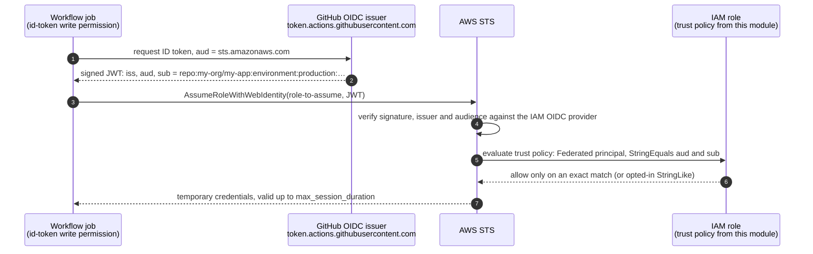

# terraform-aws-github-oidc

[](https://github.com/rahulkumar96t/terraform-aws-github-oidc/actions/workflows/ci.yml)

A Terraform module that lets GitHub Actions deploy to AWS without long-lived access keys. It creates
(or reuses) the GitHub OIDC identity provider and any number of IAM roles. You describe who may assume
each role in terms GitHub users already know: repository, branches, tags, environments, and pull
requests only if you opt in. The module turns that into a trust policy that matches the token's `sub`
and `aud` claims **exactly**. Wildcards need an explicit opt-in, and org-wide patterns such as
`repo:my-org/*` are refused unless you set a second, separate flag. The trust policy is built in plain
HCL, so the whole module is unit-tested offline with `terraform test` and a mocked AWS provider.

## Features

- Creates the `token.actions.githubusercontent.com` OIDC provider (audience `sts.amazonaws.com`), or
  takes the ARN of an existing one and checks that it belongs to the same issuer.
- Any number of roles from one `roles` map. Each role can set managed policies, inline policies, a
  permissions boundary, `max_session_duration`, path and tags.
- Subjects for branches, git tags, GitHub environments and (opt-in) `pull_request`.
- `StringEquals` on `sub` and `aud` by default. A role that sets `wildcard_match = true` gets a second
  statement with `StringLike`, and only the patterns go into it.
- Plan-time validation errors for `*`, `repo:my-org/*`, `repo:my-org/my-app:*`, wildcards without the
  opt-in, empty subject lists, missing claim values and malformed role settings.
- Customised subject templates (`include_claim_keys`), e.g. `repository_owner_id`, `repository_id`,
  `context`, `ref` or `job_workflow_ref`, set for the whole module or per repository.
- GitHub's immutable subject format `repo:OWNER@OWNER_ID/REPO@REPO_ID:…`, which survives renames
  and transfers. Check which format your organisation's tokens use before choosing.
- GitHub Enterprise Server issuers and custom audiences.
- Outputs the rendered subjects and trust policies, so you can review them in a plan.

## How it works



`aws-actions/configure-aws-credentials` performs steps 1–3 and exports the temporary credentials.
The module owns the AWS side: the OIDC provider checked in step 4 and the trust policy in step 5.

Inside the module, each `subjects` entry becomes one subject per context (branch, tag, environment,
pull request). The values are joined in the order of the claim template. The subjects are then split
into exact ones and patterns, and each group gets its own statement:

```json
{
  "Version": "2012-10-17",
  "Statement": [{
    "Sid": "GitHubActionsExactSubjects",
    "Effect": "Allow",
    "Principal": { "Federated": "arn:aws:iam::111111111111:oidc-provider/token.actions.githubusercontent.com" },
    "Action": "sts:AssumeRoleWithWebIdentity",
    "Condition": {
      "StringEquals": {
        "token.actions.githubusercontent.com:aud": "sts.amazonaws.com",
        "token.actions.githubusercontent.com:sub": ["repo:my-org/my-app:ref:refs/heads/main"]
      }
    }
  }]
}
```

## Quickstart

```hcl
module "github_oidc" {
  source = "github.com/rahulkumar96t/terraform-aws-github-oidc"

  roles = {
    my-app-deploy = {
      subjects            = [{ repository = "my-org/my-app", branches = ["main"] }]
      managed_policy_arns = { deploy = aws_iam_policy.deploy.arn }
    }
  }
}

output "deploy_role_arn" {
  value = module.github_oidc.role_arns["my-app-deploy"]
}
```

```yaml
# .github/workflows/deploy.yml in my-org/my-app
permissions:
  contents: read
  id-token: write
jobs:
  deploy:
    runs-on: ubuntu-latest
    steps:
      - uses: aws-actions/configure-aws-credentials@v6
        with:
          role-to-assume: arn:aws:iam::111111111111:role/my-app-deploy
          aws-region: eu-central-1
      - run: aws sts get-caller-identity
```

Pin the module to a release tag (`?ref=vX.Y.Z`) in real use.

Complete, runnable configurations:

| Path | What it shows |
| --- | --- |
| [`examples/basic`](examples/basic) | Creates the provider; a deploy role for `main` and a read-only role that opts in to `pull_request`. |
| [`examples/multi-environment`](examples/multi-environment) | Reuses an existing provider; dev / qa / prod roles where **prod accepts only `main` + environment `production`** through the `["repo", "context", "ref"]` template. |
| [`examples/workflows/deploy.yml`](examples/workflows/deploy.yml) | The matching workflow: one job per environment, each with `role-to-assume` from an environment variable. |

## Usage

### Branches, tags, environments

```hcl
subjects = [{
  repository   = "my-org/my-app"
  branches     = ["main"]         # repo:my-org/my-app:ref:refs/heads/main
  git_tags     = ["v1.4.0"]       # repo:my-org/my-app:ref:refs/tags/v1.4.0
  environments = ["production"]   # repo:my-org/my-app:environment:production
}]
```

The entries in a role's `subjects` list are alternatives (OR). With GitHub's default template, a job
that references an environment gets the `environment:` subject **instead of** its branch.

### Pull requests (opt-in)

```hcl
subjects = [{ repository = "my-org/my-app", pull_request = true }]  # repo:my-org/my-app:pull_request
```

### Wildcards (opt-in, per role)

```hcl
dev = {
  wildcard_match = true
  subjects       = [{ repository = "my-org/my-app", branches = ["main", "feature/*"] }]
}
```

`main` stays in the `StringEquals` statement. Only `…:ref:refs/heads/feature/*` goes to a
`StringLike` statement. Without `wildcard_match`, a `*` or `?` anywhere is a validation error, because
`StringEquals` would compare it literally and never match.

A pattern whose wildcard reaches beyond the refs of one repository (`*`, `repo:my-org/*`,
`repo:my-org/my-app:*`, or a wildcard in `repository` or an ID claim) also needs the module-level
`allow_wildcard_subjects = true`.

### Branch *and* environment (customised claim template)

GitHub's default `sub` names either the environment or the branch, never both. To make AWS check both,
set the repository's template to `["repo", "context", "ref"]` and tell the module about it:

```hcl
subject_claim_keys = ["repo", "context", "ref"]

roles = {
  prod = {
    subjects = [{
      repository   = "my-org/my-app"
      environments = ["production"]
      claims       = { ref = "refs/heads/main" }
    }]
    # -> repo:my-org/my-app:environment:production:ref:refs/heads/main
  }
}
```

On GitHub (a repository admin; `gh` shown):

```sh
gh api -X PUT repos/my-org/my-app/actions/oidc/customization/sub \
  -F use_default=false -f 'include_claim_keys[]=repo' -f 'include_claim_keys[]=context' -f 'include_claim_keys[]=ref'
```

Apply the Terraform change **before** switching the template, or the next jobs will present subjects
that no role trusts yet. During the switch, keep the old subject in `custom_subjects` so both formats
work, then remove it.

Other templates work the same way. `repo`, `context`, `repository` and `repository_owner` come from
`repository`; `repository_owner_id` and `repository_id` from `owner_id` and `repository_id`; `ref` and
`environment` from the context where possible. Every other key (`job_workflow_ref`, `workflow`, …)
comes from `claims`.

```hcl
subjects = [{
  repository    = "my-org/my-app"
  claim_keys    = ["repository_owner_id", "repository_id", "context"]  # per-repository override
  owner_id      = "1001"
  repository_id = "2002"
  environments  = ["production"]
}]
# -> repository_owner_id:1001:repository_id:2002:environment:production
```

A template without `context` renders exactly one subject per entry, and the entry must not list
branches, tags, environments or `pull_request` (they would not be enforced).

### Immutable subjects

```hcl
subjects = [{
  repository        = "my-org/my-app"
  immutable_subject = true
  owner_id          = "1001"
  repository_id     = "2002"
  branches          = ["main"]
}]
# -> repo:my-org@1001/my-app@2002:ref:refs/heads/main
```

### Reusing an existing provider, GitHub Enterprise Server

```hcl
create_oidc_provider = false
oidc_provider_url    = "https://github.example.com/_services/token"
oidc_provider_arn    = "arn:aws:iam::111111111111:oidc-provider/github.example.com/_services/token"
```

The condition keys follow the issuer (`github.example.com/_services/token:sub`). An ARN for a
different issuer is rejected, because the resulting policy could never match.

## Inputs

| Name | Type | Default | Description |
| --- | --- | --- | --- |
| `roles` | `map(object)` | `{}` | Roles to create, keyed by a stable identifier (also the default role name). See below. |
| `create_oidc_provider` | `bool` | `true` | Create the OIDC provider. Set `false` and pass `oidc_provider_arn` to reuse one. |
| `oidc_provider_arn` | `string` | `null` | Existing provider ARN. Required when `create_oidc_provider = false`, must be null otherwise. |
| `oidc_provider_url` | `string` | `https://token.actions.githubusercontent.com` | Token issuer. Change only for GHES or enterprise-specific issuers. |
| `audience` | `string` | `sts.amazonaws.com` | Required `aud` value; also the provider's client ID. |
| `thumbprint_list` | `list(string)` | `[]` | Optional thumbprints (AWS ignores them for GitHub's public issuer). |
| `subject_claim_keys` | `list(string)` | `["repo", "context"]` | Module-wide `sub` template, mirroring `include_claim_keys`. |
| `allow_wildcard_subjects` | `bool` | `false` | Permit patterns that span repositories or every ref of a repository. |
| `tags` | `map(string)` | `{}` | Tags for every resource; role tags are merged on top. |

### `roles` attributes

| Attribute | Type | Default | Description |
| --- | --- | --- | --- |
| `subjects` | `list(object)` | `[]` | Structured subjects (below). |
| `custom_subjects` | `list(string)` | `[]` | Raw `sub` values, appended verbatim. |
| `wildcard_match` | `bool` | `false` | Opt in to `StringLike` for values containing `*` or `?`. |
| `name` | `string` | map key | Role name. |
| `description` | `string` | `"Assumed by GitHub Actions through OIDC"` | Role description. |
| `path` | `string` | `"/"` | Role path. |
| `max_session_duration` | `number` | `3600` | 3600–43200 seconds. |
| `permissions_boundary` | `string` | `null` | Managed policy ARN used as boundary. |
| `managed_policy_arns` | `map(string)` | `{}` | `label => policy ARN`. Labels keep `for_each` keys static. |
| `inline_policies` | `map(string)` | `{}` | `policy name => JSON document`. |
| `tags` | `map(string)` | `{}` | Extra role tags. |

### `subjects` entries

| Attribute | Type | Default | Description |
| --- | --- | --- | --- |
| `repository` | `string` | required | `OWNER/REPO`. |
| `branches` | `list(string)` | `[]` | Context `ref:refs/heads/NAME`. |
| `git_tags` | `list(string)` | `[]` | Context `ref:refs/tags/NAME`. |
| `environments` | `list(string)` | `[]` | Context `environment:NAME`. |
| `pull_request` | `bool` | `false` | Adds context `pull_request`. |
| `claim_keys` | `list(string)` | `null` | Overrides `subject_claim_keys` for this repository. |
| `immutable_subject` | `bool` | `false` | Use `repo:OWNER@OWNER_ID/REPO@REPO_ID`. |
| `owner_id` | `string` | `null` | Numeric owner ID. |
| `repository_id` | `string` | `null` | Numeric repository ID. |
| `claims` | `map(string)` | `{}` | Values for other template keys, e.g. `ref`, `job_workflow_ref`. |

## Outputs

| Name | Description |
| --- | --- |
| `oidc_provider_arn` | ARN of the provider the roles trust (created or passed in). |
| `role_arns` | Map of role key to role ARN. |
| `role_names` | Map of role key to role name. |
| `role_subjects` | Map of role key to the rendered `sub` values. |
| `trust_policies` | Map of role key to the trust policy JSON. |

## Security notes

**Why exact matching.** `StringLike` with `repo:my-org/my-app:*` looks narrow, but it accepts every
branch anyone with write access can push, every environment and every pull request. A missing colon,
`repo:my-org/my-app*`, also accepts `my-org/my-app-sandbox` and every other repository whose name
starts with `my-app`. With exact matching, every accepted subject appears literally in the policy and
in the `role_subjects` output, so a reviewer can read exactly who gets in. Patterns therefore cost two explicit decisions: `wildcard_match` per role,
plus `allow_wildcard_subjects` for anything that spans repositories.

**`aud` is always checked.** It is an exact match in every statement, including the wildcard one, so
a token minted for another audience cannot be replayed against these roles.

**Pull requests and forks.** The `pull_request` subject is the same for every pull request in the
repository, whatever its head branch, so it is off by default. When you enable it, give the role
read-only permissions. Pull requests from forks get a read-only `GITHUB_TOKEN` and cannot be granted
`id-token: write`, unless an admin has enabled *Send write tokens to workflows from pull requests* (an
option for private repositories). Treat that setting as granting this role to fork authors. Also, never
check out and run pull request code in a `pull_request_target` job that can request `id-token: write`:
that trigger runs with the base repository's privileges.

**Environment protection rules.** With the default template, an `environment:production` subject
says nothing about the branch. Whatever the environment allows, the role allows. Configure required
reviewers and a deployment branch rule (`main` only) on the environment. Make sure it exists before you
trust it: GitHub creates a missing environment, without protection rules, the first time a workflow
references it. The `["repo", "context", "ref"]` template adds a second check that GitHub settings
alone cannot loosen: AWS itself verifies `ref:refs/heads/main`.

**Renames.** Default subjects use names. If an organisation or repository is renamed or deleted and its
old name is registered again, the old subjects match the new owner. Prefer the immutable format or an
ID-based template (`repository_owner_id`, `repository_id`) for long-lived roles.

**Case.** IAM string conditions are case-sensitive. Spell environment and branch names exactly as
they appear in the token.

**Blast radius.** Use one role per environment and per purpose, a permissions boundary on production
roles, and the shortest `max_session_duration` that works. The configure-aws-credentials action asks
for one hour by default.

## Design decisions and trade-offs

- **Trust policy in `jsonencode`, not `aws_iam_policy_document`.** The data source would be mocked in
  tests and return a placeholder, so nothing about the policy could be asserted. Building it in HCL
  makes the document deterministic, testable offline and visible in `plan` once the provider ARN is
  known.
- **Validation on the variable, not preconditions.** Mistakes surface as `Invalid value for variable`
  at the start of `plan`, with the offending role names in the message. The rules run on the raw input,
  so they repeat a little of the rendering logic (for example, which claim keys can be derived). That
  is the price of failing before any resource is evaluated.
- **One statement per operator.** Mixing `StringEquals` and `StringLike` on `sub` in a single condition
  block would AND them. Two statements keep exact subjects exact when a role also has patterns.
- **Labels for managed policies.** `managed_policy_arns` is a map so that `for_each` keys are known at
  plan time even when the ARN comes from a policy created in the same apply.
- **Derived values win over `claims`.** For a branch context, `ref` is always the branch itself. A
  `claims.ref` only fills in where nothing can be derived (environments). That way a stale claim cannot
  produce a subject that never occurs.
- **`:` is rejected in names.** GitHub escapes colons inside claim values. Rather than guessing the
  encoding and producing a subject that silently never matches, the module refuses such values and
  points to `custom_subjects`.
- **Trust policy size is a warning.** A `check` block warns above 2,048 characters, the default IAM
  quota. Because the quota can be raised, it does not block the apply.

## Testing

```sh
terraform init -backend=false
terraform test
```

43 `run` blocks in six files, all against `mock_provider "aws"`, so no AWS credentials or network
access to AWS are needed. Only the provider download from the Terraform registry needs network.

| File | Runs | Covers |
| --- | --- | --- |
| `tests/trust_policy.tftest.hcl` | 6 | Decoded trust policies: exact `Condition` blocks, `aud`, principal, action, PR opt-in, operator split, de-duplication |
| `tests/claim_templates.tftest.hcl` | 5 | ID-based templates, per-repository overrides, `job_workflow_ref`, immutable format, derived vs. claimed `ref` |
| `tests/provider.tftest.hcl` | 8 | Provider created vs. reused, GHES issuer and audience, thumbprints, provider-only use, three invalid combinations |
| `tests/role_options.tftest.hcl` | 4 | Boundary, session length, path, name, tag merge, managed and inline policies, policy size warning |
| `tests/validation.tftest.hcl` | 18 | `expect_failures` for `*`, `repo:my-org/*`, `repo:…:*`, wildcards without opt-in, empty subjects, missing claim values, bad IDs, names, sessions, boundaries, JSON |
| `tests/examples.tftest.hcl` | 2 | Both examples, including the exact prod statement of the multi-environment example |

CI (`.github/workflows/ci.yml`) runs `terraform fmt -check -recursive`, `init -backend=false` and
`validate` for the module and both examples, `terraform test`, and `actionlint` on the CI workflow
and the example workflow. The same commands pass locally with Terraform 1.13.2 and actionlint
1.7.12. CI downloads that actionlint version with its official script.

## Limitations and roadmap

- **No end-to-end test against AWS.** The tests prove what the module renders, not that STS accepts
  it. The policy shapes follow the AWS and GitHub documentation, but this repository has no live
  `apply` in CI.
- **Only `sub` and `aud` are conditioned.** The module enforces other claims (actor, workflow, runner
  environment) only if you add them to the `sub` template.
- **The GitHub side is not managed.** The `include_claim_keys` template and environment protection
  rules have to be configured on GitHub (API, UI or the GitHub Terraform provider). The module only
  has to be told which template is in use.
- **One provider per issuer per account.** Create it once (`create_oidc_provider = true` in one stack)
  and pass `oidc_provider_arn` everywhere else.
- **Policy attachments are additive.** Policies attached to the role outside Terraform are not removed.
  Optional exclusive management (`aws_iam_role_policy_attachments_exclusive`) is a possible addition.
- Values containing `:` must go through `custom_subjects`.
- Requires Terraform >= 1.9 (cross-variable validation) and AWS provider >= 6.0. Tested with Terraform
  1.13.2 and the provider version in `.terraform.lock.hcl`.

## License

[MIT](LICENSE)
